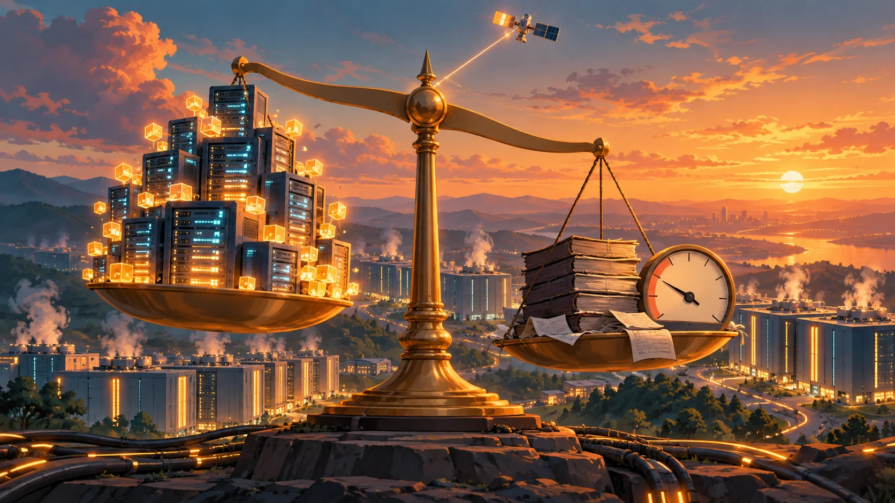
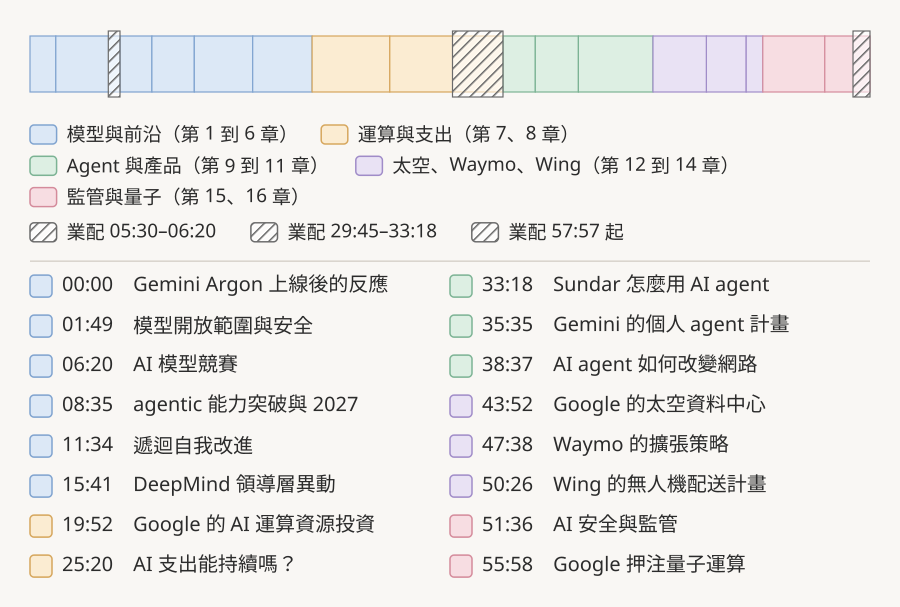

# 容量吃緊、現金流轉負，Google 還要往前押：Sundar Pichai 談 Argon、運算資源與太空資料中心

*封面插圖為本文以概念比喻繪製：一邊是不夠用的運算資源，一邊是轉負的帳，天平頂端遠處還有一顆衛星。*

> 本導讀的分析與撰稿由 AI 模型完成，不是人類分析，也沒有經過人工逐句校稿。訪談全文的繁中譯文見[譯文頁](translation-zh.html)，想邊看影片邊對照中英字幕，可以用[播放器頁](player.html)；翻譯、查證、審稿與插圖的模型分工見文末〈製作說明〉。文中重要說法都附來源連結，請以來源為準。

## 負 58.55 億美元

Alphabet 2026 年第二季的自由現金流（大致是營運賺進的現金，減掉買設備、蓋資料中心的支出）是**負 58.55 億美元**。同一份財報稿（[SEC 8-K 附件 99.1](https://www.sec.gov/Archives/edgar/data/0001652044/000165204426000066/googexhibit991q22026.htm)）寫著：營運現金流 390.69 億美元，購置不動產與設備 449.24 億美元；前一季的自由現金流還是正 101.16 億。（已確認）

10 月 21 日，Alex Heath 的 Sources Podcast 上架了他對 Google 與 Alphabet 執行長 Sundar Pichai 的專訪，時間點是 Gemini 4 Argon 擴大開放後約一週。Heath 把這件事丟到 Pichai 面前：「今年夏天有個重要時刻，你們自公司 IPO 以來首次出現現金流轉負」（[22:51](https://www.youtube.com/watch?v=fJBSNEFdm8c&t=1371s)），接著問他：「你看到了什麼，才帶給你這樣的決心？」（[23:14](https://www.youtube.com/watch?v=fJBSNEFdm8c&t=1394s)）

Pichai 第一句話是：「是我們所看到的需求訊號的強度與持久性。」（[23:27](https://www.youtube.com/watch?v=fJBSNEFdm8c&t=1407s)）

這句話撐得住多少？訪談前半幾乎都繞著這一題。Pichai 一開場就說 Argon 上線時容量吃緊（[00:54](https://www.youtube.com/watch?v=fJBSNEFdm8c&t=54s)），後面談到運算資源是兩年前就得決定的事、談到泡沫、談到太空資料中心，幾乎都回到同一個問題：**需求夠不夠真，真到值得在現金流轉負時繼續加碼**。

這篇導讀把他的主要說法，一項一項對上 Google 自家公告、財報和外部報導，看哪些有書面佐證，哪些是他的自述，哪些主持人說得比事實更寬。文中括號標示可信度：已確認＝有官方或一手文件佐證，且至少兩路查證一致；當事方自揭＝只有 Pichai 或所屬公司自己的說法；單方說法＝只有單一來源或單一方的說詞；有爭議＝來源之間互相衝突。

先講幾件事。影片中穿插三段業配（約 [05:30](https://www.youtube.com/watch?v=fJBSNEFdm8c&t=330s) 到 06:20、[29:45](https://www.youtube.com/watch?v=fJBSNEFdm8c&t=1785s) 到 33:18，以及 [57:57](https://www.youtube.com/watch?v=fJBSNEFdm8c&t=3477s) 之後的片尾），邊界以字幕實際時間為準，本文不當內容。訪談錄在 Alphabet 第三季財報之前，第三季財報要到 10 月 28 日才公布（[Alphabet](https://abc.xyz/investor/news/news-details/2026/Alphabet-Announces-Date-of-Third-Quarter-2026-Financial-Results-Conference-Call-2026-8tpGZsLS6v/default.aspx)），所以本文引用的財報最新到 2026 年第二季，資料截至 2026-10-25。

*圖：訪談 16 個章節與三段業配的位置，章名依影片說明欄翻譯，起點取自說明欄，業配邊界取自字幕時間。本文整理。*

## 先看重點

| 主題 | Pichai 的說法 | 對照結果 |
|---|---|---|
| Argon 上線 | 頭 72 小時近 25 兆 token，約 3.0 同期的 3 倍；容量吃緊 | 9/30 先給 Fairwind 資安防禦者、10/13 擴大開放（已確認）；token 數字 Google 官方沒有公布，Sources 的文字版只是重述同一組數字（當事方自揭） |
| 3.5 Pro 去哪了 | Argon 預訓練已完成，3.5 Pro 的「生命週期將會非常短暫」，經驗改用在 Argon 後訓練 | 5/19 I/O 官方預告「下個月推出」之後沒有發布（已確認）；原因是 Pichai 的說法（當事方自揭），Bloomberg 報導是程式能力不達標（單方說法） |
| Minecraft 與成本 | 主持人說 Argon 自行破關，花一天多、運算成本不到 2,000 | 事件有論文（已確認）；成本各報導的計算方式不同，單位字幕沒說（有爭議） |
| 遞迴自我改進（RSI） | 研究員與模型深度協作，預期未來 12 個月因 RSI 持續加速 | 屬預測，無從查證（當事方自揭） |
| DeepMind 人事 | Demis 仍是 DeepMind 主席，Koray 接手，Jeff Dean 創辦 Discovery Loop | 官方公告逐項吻合（已確認）；官方稱 Koray 為 SVP，公司名稱由媒體報導 |
| 運算資源與現金流 | 運算資源決策是兩年前做的；信心來自需求訊號與附承諾營收的長期合約 | 第二季自由現金流 −58.55 億（已確認）；上調的是 2026 年資本支出指引，主持人說的 2027 年沒有數字 |
| 泡沫 | 這不是光纖；產業仍可能投資過頭 | CoreWeave 本週股價與債券承壓，沒有倒閉（單方說法） |
| 常駐 agent | 企業與消費者用同一套模型、harness、執行環境；每項任務一個 micro VM | 10/8 Gemini agent 官方發表（已確認）；micro VM 與「同一套」是 Pichai 自述，官方用語是 Agent Sandbox |
| 太空資料中心 | 運作良好，會有機會向 TPU 打招呼 | 10/1 原型衛星發射（已確認）；TPU 運算結果尚未見公開報告；原型不在太陽同步軌道 |
| Waymo | 每週付費乘車剛突破 50 萬次、多倫多即將上線、嚴重事故少 95% | 50 萬次 3 月就已公開；多倫多是 10/16 宣布的試驗；95% 對應官方「嚴重傷害以上事故」−94.82%，任何傷害為 −82%（當事方自揭，Waymo 自行發布） |
| Wing | 主持人說 4,000 萬個美國家庭 | 官方寫的是逾 4,000 萬名美國人，不是家庭 |
| 監管 | 主張全國統一法規；自願送測是一年前沒有的轉變 | 對 Google 成立（5 月簽署），對 OpenAI、Anthropic 不成立（更早）（已確認） |
| 量子 | 5 年內出現實際商業應用 | 屬預測（當事方自揭） |

## 一、Argon 上線：用量、容量，與誰先拿到

訪談開頭，Pichai 把 Argon 放在「世界級的前沿模型」這一格：廣度與深度相當全面，在 agentic 任務（模型自己分步驟執行的工作）、知識工作、寫程式這張「熱圖」上許多維度都非常強（[00:16](https://www.youtube.com/watch?v=fJBSNEFdm8c&t=16s)）。接著給了一組數字：上線最初 72 小時，「我們處理了將近 25 兆 token，大約是 3.0 前 72 小時的 3 倍」（[00:40](https://www.youtube.com/watch?v=fJBSNEFdm8c&t=40s)–[00:47](https://www.youtube.com/watch?v=fJBSNEFdm8c&t=47s)）。token 是模型處理文字時的計量單位，大致等於一個字詞片段。

這組數字在 Google 的公告和開發者文件裡都找不到，也沒有說「上線」是 9 月 30 日還是 10 月 13 日。能找到的另一個出處是 Sources 同日的文字版，Heath 寫的是「Pichai tells me Argon processed almost 25 trillion tokens in its first 72 hours」，**同一組數字、同一位講者，不構成獨立佐證**（[Sources](https://sources.news/p/sundar-pichai-gemini-4-google-other-bets)）。單位上，英文的 trillion 是兆，「近 25 兆」沒有寫錯。（當事方自揭）

開放順序，官方文件寫得比較清楚。9 月 30 日 Google 宣布 Argon，先透過 DeepMind 的 [Fairwind Program](https://deepmind.google/fairwind-program/) 給一批通過審核的資安防禦者，同時參與美國政府自願性的上市前模型存取流程（[Google，2026-09-30](https://blog.google/innovation-and-ai/models-and-research/gemini-models/gemini-4-argon/)）。10 月 13 日起，Gemini app 與搜尋的 AI Mode 開放給 Google AI Pro 與 Ultra 訂閱者，開發者透過 AI Studio（Google 的開發者平台）使用 Gemini API 的付費層，Antigravity（Google 的 AI 寫程式工具）則列給 Ultra 訂閱者（[Google，2026-10-13](https://blog.google/innovation-and-ai/models-and-research/gemini-models/introducing-gemini-4-argon/)）。（已確認）

Pichai 的描述是：上線時開放所有 Ultra 方案和 Gemini app 的 Pro 方案，「隨後我們又在 Antigravity 應用程式中向 Pro 方案開放」（[03:20](https://www.youtube.com/watch?v=fJBSNEFdm8c&t=200s)–[03:28](https://www.youtube.com/watch?v=fJBSNEFdm8c&t=208s)）。官方 10 月 13 日的文章只把 Antigravity 列給 Ultra 訂閱者，Pro 方案未見官方說明；10 月 15 日前後有報導說已開放 Pro，另有報導說 Antigravity 桌面 app 與 CLI 需要 Ultra，兩種說法互相衝突（有爭議）。

為什麼設限？主持人先講：Argon 是龐大的模型，服務成本高。Pichai 的答案有兩層。一層是蒸餾：3.0 時期他們就很擅長把大模型蒸餾成「能力幾乎相當但效率高出許多的版本」，這類模型正在研發，「效率更高的版本即將推出」（[02:16](https://www.youtube.com/watch?v=fJBSNEFdm8c&t=136s)、[03:56](https://www.youtube.com/watch?v=fJBSNEFdm8c&t=236s)）。沒有名稱，也沒有日期，官方文件同樣沒有這項宣布（當事方自揭）。

另一層是安全。他說 Argon 具備 agentic 能力又很會寫程式，部署給大量企業客戶時，除了模型對齊，更重要的是「在它們運作時用來監控它們的運算資源與所構建的系統」，監控本身也很耗運算，他還說要先建好沙箱隔離和即時監控（[04:26](https://www.youtube.com/watch?v=fJBSNEFdm8c&t=266s)–[05:10](https://www.youtube.com/watch?v=fJBSNEFdm8c&t=310s)）。這段先記著，後面談 Gemini agent 時會再出現。

主持人還問到一個傳聞：「這就是傳聞中的 Carbon 模型嗎？」（[03:38](https://www.youtube.com/watch?v=fJBSNEFdm8c&t=218s)）Pichai 沒有確認也沒有否認，只說任何時間點都有前沿模型的內部版本，「其中有些就是那些版本的代號」，那跟推出高效率版 Argon 是兩回事（[03:41](https://www.youtube.com/watch?v=fJBSNEFdm8c&t=221s)）。傳聞的出處是 Business Insider 10 月 9 日的獨家報導，說 Carbon 是 Gemini 4 的內部測試版本，Google 拒絕評論（單方說法，經轉述）。

## 二、3.5 Pro 去哪了，與「三個月」的節奏

主持人問的是個很具體的問題：「我上次參加 Google I/O 時，你們提到了 Gemini 3.5 Pro」，後來它怎麼了，是變成了 Argon 嗎？（[12:46](https://www.youtube.com/watch?v=fJBSNEFdm8c&t=766s)）

先把前提對上。Google 在 5 月 19 日的 I/O 當天發表 Gemini 3.5，文章寫「We're also hard at work on 3.5 Pro. It's already being used internally, and we look forward to rolling it out next month」（[Google，2026-05-19](https://blog.google/innovation-and-ai/models-and-research/gemini-models/gemini-3-5/)）。6 月沒有出現。DeepMind 的 Pro 頁面（未標日期）到本文查閱時仍寫 3.5 Pro「coming soon」（[DeepMind](https://deepmind.google/models/gemini/pro/)）。（已確認）

Pichai 的解釋分三步（[13:01](https://www.youtube.com/watch?v=fJBSNEFdm8c&t=781s)–[14:05](https://www.youtube.com/watch?v=fJBSNEFdm8c&t=845s)）。訓練 3.5 系列到中期，他們發現 agentic 能力、尤其寫程式有差距，要衝高表現，最快的方式是用較小的 Flash 反覆迭代，「這就是為什麼會一路從 3.5 到 3.6、3.7 再到 3.8 Flash」。等這些做完、可以套用到 Pro 時，「Argon 的預訓練已經完成了」，於是「我們意識到 3.5 Pro 的生命週期將會非常短暫」，決定把學到的經驗用在 Argon 的後訓練。

外部報導給的版本不太一樣。9to5Google 7 月 16 日的報導說 6 月目標沒有達成，Bloomberg 的說法是為了改進程式能力、6 月下旬更新訓練資料的結果不如預期。兩種解釋可以同時成立，Pichai 講的是決策邏輯，Bloomberg 講的是當時的進度，但這段原因目前沒有 Google 官方說明（Pichai 的部分為當事方自揭，Bloomberg 的部分為單方說法）。

「三個月」的部分，四篇官方發布文的日期是：3.5 Flash 5 月 19 日（[Google](https://blog.google/innovation-and-ai/models-and-research/gemini-models/gemini-3-5/)）、3.6 Flash 7 月 21 日（[Google](https://blog.google/innovation-and-ai/models-and-research/gemini-models/gemini-3-6-flash-3-5-flash-lite-3-5-flash-cyber/)）、3.7 Flash 8 月 13 日（[Google](https://blog.google/innovation-and-ai/models-and-research/gemini-models/introducing-gemini-3-7-flash/)）、3.8 Flash 9 月 2 日（[Google](https://blog.google/innovation-and-ai/models-and-research/gemini-models/3-8-flash-and-3-8-flash-cyber/)）。從 3.5 到 3.8 約 3.5 個月，他說「大約在 3 個月內走完」（[08:22](https://www.youtube.com/watch?v=fJBSNEFdm8c&t=502s)），略短；3.6 之後每一版的間隔都只有約三週。（已確認）

談到 Argon 的程式能力，Pichai 的措辭是個條件句：「如果看兩個月前，Argon 在寫程式的各個面向都算得上是前沿」（[14:44](https://www.youtube.com/watch?v=fJBSNEFdm8c&t=884s)）。**他比的是兩個月前的前沿。**外界評價也不一致：Bloomberg 9 月 30 日報導有員工質疑 Argon 在實務程式任務上的表現，Google 回應說，指 Gemini 4 在程式等領域表現不佳並不準確（單方說法，經轉述）。

## 三、Minecraft 與 Chromium：兩個 agentic 示範

接下來是主持人帶進來的案例：「它在 1 天多一點的時間內自行破關了 Minecraft，而且我記得花費不到 2,000 的運算資源」（[08:37](https://www.youtube.com/watch?v=fJBSNEFdm8c&t=517s)）。

事件有第一手來源：arXiv 的論文 *A team of Gemini 4 Argon agents beats Minecraft*（[arXiv:2610.22319](https://arxiv.org/abs/2610.22319)，10 月 15 日提交），4 個 Argon agent、隨機生成的世界、Easy 難度、約 27 小時 14 分打敗終界龍。（已確認）成本只見於媒體報導，計算方式不一（約 520、810、1,040、1,620 美元都有人引用），都低於 2,000，與主持人說法相容；字幕沒有說單位，本文推定是美元，論文頁未見成本數字（有爭議）。

Pichai 接這個問題時，講的是另一個案例，Chromium。他說內部把 Argon 指向數百萬行程式碼的大型專案，例如想做一種體驗，「可以把分頁拖曳出來、移動它、放進 AI 體驗中，要如何讓它在不重載的情況下保持即時運作」，以往對團隊是牽涉 Chromium 所有架構層的工程，現在「你可以把 Argon 指向它，它就能持續不斷地鑽研並把事情完成」（[09:04](https://www.youtube.com/watch?v=fJBSNEFdm8c&t=544s)–[09:50](https://www.youtube.com/watch?v=fJBSNEFdm8c&t=590s)）。

Google 官方在 Argon 發表文裡有同一件事：把核心網頁處理從 Chromium 約 4,000 萬行程式碼中約 600 萬行的舊目錄分離，跨數百個檔案重構，「數個月的工作在數週內完成」，並預期消除一整類瀏覽器當機（[Google，2026-10-13](https://blog.google/intl/en-in/products/introducing-gemini-4-argon/)）。**這是 Google 自述，沒有第三方量測**（當事方自揭）；「消除一整類當機」是預期。

他的結論是：「我認為在某種程度上，我將 2027 年視為我們生產力前沿的黃金年代」（[10:01](https://www.youtube.com/watch?v=fJBSNEFdm8c&t=601s)），原因是新一代模型加上「我們將其與內部環境整合得如此良好」（[10:12](https://www.youtube.com/watch?v=fJBSNEFdm8c&t=612s)）。前一句把功勞給模型，後一句把功勞給與內部環境的整合，第八節談 harness 時會回到這一點。這是意見與預期，無法查證。

## 四、遞迴自我改進：一個連續譜，加一句預測

主持人說：「我最近也聽說 Sergey 在談論 RSI，並在這方面推動團隊。」（[11:34](https://www.youtube.com/watch?v=fJBSNEFdm8c&t=694s)）遞迴自我改進（RSI）指的是 AI 參與改進下一代 AI。Pichai 回得很小心，用的是連續譜的講法，沒有說「已經發生」。

他先講人：考量到安全，這些事情有許多都需要人在迴路中參與（[11:52](https://www.youtube.com/watch?v=fJBSNEFdm8c&t=712s)）。再講現況：「我們絕對已經處於 AI 研究人員與模型深度協作的階段」，模型可能自動提出訓練配方建議、評估下一個 checkpoint（訓練途中存下的模型版本，[11:59](https://www.youtube.com/watch?v=fJBSNEFdm8c&t=719s)–[12:06](https://www.youtube.com/watch?v=fJBSNEFdm8c&t=726s)）。接著是他措辭最謹慎的一句：流程中有些面向「可能更接近我所謂這種光譜上更偏向 RSI 的狀態。有些環節程度較低，但整個光譜都在轉移」（[12:19](https://www.youtube.com/watch?v=fJBSNEFdm8c&t=739s)–[12:27](https://www.youtube.com/watch?v=fJBSNEFdm8c&t=747s)）。最後才是預測：「我預期未來 12 個月將因 RSI 而持續加速」（[12:40](https://www.youtube.com/watch?v=fJBSNEFdm8c&t=760s)）。

**這四句的證據強度是遞減的**：人在迴路中是做法的描述；深度協作是現況的自述；光譜在轉移是判斷；加速是預測。沒有一句附了數字，Google 公開文件裡也沒有對應的量測。本系列前一篇導讀（另一場 Pichai 訪談）整理過 Google 自家安全報告的說法：報告寫的是目前「沒有顯著的端到端 AI 研發加速」，與 Pichai 在這裡的措辭相容（見[前一篇導讀](https://lushinshang.github.io/sundar-pichai-recursive-self-improvement/)）。（當事方自揭）

主持人提到 Brin 也在談 RSI，這部分有媒體報導，Business Insider 轉述他在 10 月 14 日的 Argon 圓桌上說 Google 正「starting to get onto that RSI treadmill」（單方說法，經轉述）。

Pichai 也順口舉了別家：數學這類可驗證領域，「就像 OpenAI 最近的模型在數學方面所展現的一樣」（[11:19](https://www.youtube.com/watch?v=fJBSNEFdm8c&t=679s)）。他沒說是哪一項。5 月 OpenAI 宣布模型推翻 Erdős 單位距離猜想，10 月初又公開大批 AI 產生的數學手稿，專家評價兩極、已有撤回（[Scientific American](https://www.scientificamerican.com/article/the-most-exciting-claims-from-openais-heap-of-new-proofs/)），所以這句話指的是哪一件，無從判斷。

## 五、DeepMind 人事：官方公告怎麼寫

主持人整理了一遍：Demis Hassabis「退居二線，轉任首席科學家」，Koray 升任掌舵，Jeff Dean 離職創辦 Discovery Loop（[15:46](https://www.youtube.com/watch?v=fJBSNEFdm8c&t=946s)–[15:55](https://www.youtube.com/watch?v=fJBSNEFdm8c&t=955s)）。Pichai 後來補了一句，Demis「仍以 DeepMind 主席身分參與」（[18:40](https://www.youtube.com/watch?v=fJBSNEFdm8c&t=1120s)）。兩人說的職稱不同，會讓人以為有一邊講錯。

官方的信是 8 月 5 日發的，署名 Pichai 與 Hassabis（[Google，The next chapter of our AI momentum](https://blog.google/company-news/inside-google/message-ceo/next-chapter-ai-momentum/)；日期依 [9to5Google](https://9to5google.com/2026/08/05/demis-hassabis-deepmind/) 與 Investing.com 報導）。信裡寫：Demis 成為 GDM 的 Chair 和 Alphabet 的 Chief Scientist，同時繼續領導 Isomorphic Labs；Koray 從 GDM 的 CTO 兼 Chief AI Architect 升任 SVP of Google DeepMind，向 Pichai 報告，負責 Gemini 模型研發、前沿 AI 研究、Gemini app 與開發者團隊；Jeff Dean 在 Google 27 年後，與 Google Senior Fellow Sanjay Ghemawat 成立獨立的公益公司，Google 是創始投資人與雲端夥伴。（已確認）

**所以主持人和 Pichai 都對：Demis 是 Chair 也是 Alphabet 首席科學家。**要小心的是兩處。一是 Koray 的官方職稱是 SVP，主持人說「掌舵 DeepMind」是口語；二是官方信沒有出現 Discovery Loop 這個名稱，名稱來自 9to5Google 和 Wired 報導，字幕沒有聽錯。另外，公司是 Dean 與 Ghemawat 一起成立的。

主持人要他回應外界的臆測（「也許你能平息一些謠言」，[16:16](https://www.youtube.com/watch?v=fJBSNEFdm8c&t=976s)）。Pichai 繞開內幕，從結構講起：前沿模型開發如今是「極為耗費心力」的事，「從資料、運算資源、演算法工作，一路到管理團隊」（[16:56](https://www.youtube.com/watch?v=fJBSNEFdm8c&t=1016s)–[17:22](https://www.youtube.com/watch?v=fJBSNEFdm8c&t=1042s)）；Demis 想把更多時間花在 AI 安全，以及把 AGI 用在藥物探索、機器人、醫療（[17:41](https://www.youtube.com/watch?v=fJBSNEFdm8c&t=1061s)–[18:09](https://www.youtube.com/watch?v=fJBSNEFdm8c&t=1089s)）；模型開發「某種程度上……已經是一個相當成熟的流程」，所以讓 Koray 接手（[18:21](https://www.youtube.com/watch?v=fJBSNEFdm8c&t=1101s)）。官方信對 Hassabis 新角色的描述與此一致。

DeepMind 和 Google 其他部門的關係，Pichai 說這是多年來的自然歷程：Gemini app 在 DeepMind 內部打造，Koray「大概在快要 18 個月前就搬到了灣區」（[19:10](https://www.youtube.com/watch?v=fJBSNEFdm8c&t=1150s)–[19:22](https://www.youtube.com/watch?v=fJBSNEFdm8c&t=1162s)）。Gemini app 團隊歸 GDM 這一點與官方信吻合；搬遷時間查不到公開紀錄（當事方自揭）。

## 六、運算資源這筆帳：兩年前的決定，與信心從哪來

主持人問他怎麼在長期研究和近期產品之間分配運算資源。Pichai 的回答先講底線：「我們很長一段時間以來都是一家 AI 優先的公司」，承諾投入前沿研究與模型開發所需的運算資源，這是規劃的基本出發點；除此之外，各業務單位例如雲端團隊有自己的長期規劃與營收預測，Google 據此為他們規劃運算資源（[20:49](https://www.youtube.com/watch?v=fJBSNEFdm8c&t=1249s)–[21:12](https://www.youtube.com/watch?v=fJBSNEFdm8c&t=1272s)）。也就是研究墊底、業務往上疊；兩者衝突時誰讓誰，他沒有說。

然後是這場訪談最具體的一段時間描述。「請記住，我們的運算資源都是自己建置的，對吧？那需要很長的前置時間。」（[21:31](https://www.youtube.com/watch?v=fJBSNEFdm8c&t=1291s)）所以：「在任何一個時間點，你都得承受自己 2 年前做出的所有運算資源決策。」（[21:38](https://www.youtube.com/watch?v=fJBSNEFdm8c&t=1298s)）他接著說，今天沒有任何一家公司敢說 2 年前的決定現在看來是對的（[22:02](https://www.youtube.com/watch?v=fJBSNEFdm8c&t=1322s)）。這等於把現在的容量吃緊，解釋成兩年前的押注還沒蓋完；**照同樣的邏輯，今天的支出對不對，也要兩年後才看得出來。**

接下來是文章開頭那段。主持人點出夏天現金流轉負，以及「我想你們上調了 2027 年的資本支出指引」（[23:07](https://www.youtube.com/watch?v=fJBSNEFdm8c&t=1387s)）。事實要拆開看。

- **現金流**：負 58.55 億美元是 2026 年第二季（4 到 6 月）、Alphabet 自己定義的自由現金流；過去 12 個月合計仍是正 532.73 億（[SEC 8-K](https://www.sec.gov/Archives/edgar/data/0001652044/000165204426000066/googexhibit991q22026.htm)）。「自公司 IPO 以來首次」是主持人的說法，Alphabet 的財報稿沒有這句；引用 Dow Jones 市場資料的二手報導有這個說法，BBC 轉載稿寫的是「近十年來第一次」。（已確認數字；「首次」的範圍為單方說法）
- **資本支出指引**：7 月 22 日第二季電話會議上調的是 2026 年的指引，從 1,800 到 1,900 億美元調到 1,950 到 2,050 億美元；財務長另說「我們持續預期 2027 年的資本支出將顯著增加，細節稍後提供」，語氣是延續先前說法（「as we previously shared」），沒有數字（[官方逐字稿](https://s206.q4cdn.com/479360582/files/doc_events/2026/Jul/22/2026_Q2_Earnings_Transcript.pdf)）。主持人說的「上調 2027 年指引」並不精確。（已確認）

Pichai 的回答列了五層信心（[23:27](https://www.youtube.com/watch?v=fJBSNEFdm8c&t=1407s)–[25:05](https://www.youtube.com/watch?v=fJBSNEFdm8c&t=1505s)）：從消費端到企業端的多元需求訊號；Google 自己內部使用 AI 的需求；獨立於需求之外、客觀評估能力前沿的曲線（成本、新舊模型對比、任務複雜度、內部評測）；研究突破讓他判斷「Gemini 5.0 會不會比 Argon 好很多；答案是會」（[24:38](https://www.youtube.com/watch?v=fJBSNEFdm8c&t=1478s)）；最後是「我們也有穩定的長期合約，附帶已承諾營收，而且正在簽訂中。所以，這不只是抱著希望，對吧？」（[24:56](https://www.youtube.com/watch?v=fJBSNEFdm8c&t=1496s)–[25:02](https://www.youtube.com/watch?v=fJBSNEFdm8c&t=1502s)）

五層裡可以從外面驗證的只有最後一層。第二季電話會議公布 Google Cloud 未交付訂單（backlog）到季底是 5,140 億美元，公司預期其中略超過一半會在 24 個月內認列為營收（[官方逐字稿](https://s206.q4cdn.com/479360582/files/doc_events/2026/Jul/22/2026_Q2_Earnings_Transcript.pdf)）。（已確認）前四層，內部評測曲線、內部需求、對 5.0 的判斷，都是 Google 自己才看得到的資料。

> 重點：最硬的那一層是合約，而那是已簽約、還沒認列的既有訂單，跟他說的「正在簽訂」的新合約不是同一個數字。

資料中心用電那段也值得補一個日期。他說「甚至在 5 年前，我們就用 AI 提升資料中心的用電效率」（[35:05](https://www.youtube.com/watch?v=fJBSNEFdm8c&t=2105s)）。Google 與 DeepMind 公布「AI 降低資料中心冷卻能耗 40%」是 2016 年（[DeepMind](https://deepmind.google/blog/deepmind-ai-reduces-google-data-centre-cooling-bill-by-40/)），約十年前；他說的「甚至」是至少的意思，不能當作起點。（已確認）

## 七、「這不是光纖」：泡沫的問題，與一個被他分開的概念

主持人把問題推到產業：CoreWeave 是最新的例子，大家也擔心新興雲端業者（neocloud）的融資，這個市場會不會「衝過頭」了（[25:28](https://www.youtube.com/watch?v=fJBSNEFdm8c&t=1528s)）。CoreWeave 這週確實承壓：10 月 20、21 日前後股價與債券走弱（CNBC、Morningstar 報導），是融資與市場信心的壓力，沒有倒閉或違約（單方說法，經轉述）。

Pichai 的回答有一個很容易漏掉的轉折。他先說：「我想沒有人會覺得這就像過去那場泡沫。這不是光纖那種情況，對吧？」接著是「我們正在使用這些資源」、「我們的資源非常吃緊」，而且「現在這些資源確實在發揮實際價值」（[28:36](https://www.youtube.com/watch?v=fJBSNEFdm8c&t=1716s)–[28:52](https://www.youtube.com/watch?v=fJBSNEFdm8c&t=1732s)）。接著他把話分成兩件事：「但這不代表整個產業或經濟就不會集體投資過頭，或是……也不代表系統不會遭遇我們無法控制的衝擊」（[28:58](https://www.youtube.com/watch?v=fJBSNEFdm8c&t=1738s)–[29:06](https://www.youtube.com/watch?v=fJBSNEFdm8c&t=1746s)）。

**他把需求是真的，和整個產業不會投資過頭拆成兩件事**：前者他拿 Google 自己的容量吃緊當證據；後者他不打包票，只說自己把精力放在「我們能掌控的事情上」：長期觀點、多年累積的預測與建模、有紀律的投資（[29:13](https://www.youtube.com/watch?v=fJBSNEFdm8c&t=1753s)–[29:34](https://www.youtube.com/watch?v=fJBSNEFdm8c&t=1774s)）。第六節那些信心，說的就是這個「我們能掌控的」部分。至於整個市場是否過熱，他說自己花的心思比較少。

他還舉了疫情：「那幾年我們投入了大量人力成長在 Google Cloud」，Google 進入雲端市場相對較晚，但有「6 到 8 年的時間」採取非常積極的投資策略，這讓他們度過現在這樣的時刻（[27:13](https://www.youtube.com/watch?v=fJBSNEFdm8c&t=1633s)–[27:39](https://www.youtube.com/watch?v=fJBSNEFdm8c&t=1659s)）。「進入較晚」有公開時間線可對：AWS 的 EC2 在 2006 年上線，Google Compute Engine 2013 年底才正式推出。人力成長主要投入 Cloud 與 6 到 8 年這兩點查不到外部資料，Alphabet 的年報不單獨列 Cloud 的人數（當事方自揭）。

這段有一句字幕要小心：[26:43](https://www.youtube.com/watch?v=fJBSNEFdm8c&t=1603s) 機器字幕寫成 inability to take a long-term view，對照上下文與 [29:13](https://www.youtube.com/watch?v=fJBSNEFdm8c&t=1753s) 的 ability to take a long-term view，應為 ability，中文依語意處理，本文不拿這一句當論據。

## 八、Pichai 自己怎麼用 agent，Gemini agent 又是什麼

主持人問，AI 會不會替 Google 做運算資源配置的決定。Pichai 先說決策是「完全由人在迴路中做出，包括我在內」（[33:40](https://www.youtube.com/watch?v=fJBSNEFdm8c&t=2020s)），然後講自己的用法：他有 agent 在內部替他跑，一個是整理模型開發的進展。預訓練、中期訓練、後訓練各有聊天群組，過去「要追上過去 24 小時發生的事，我每天很容易就得花上 1 小時」，現在 agent 整理好給他，他還是會深入看（[34:07](https://www.youtube.com/watch?v=fJBSNEFdm8c&t=2047s)–[34:33](https://www.youtube.com/watch?v=fJBSNEFdm8c&t=2073s)）；另一個是對運算資源用量、效率、使用率有遙測資料的 agent（[34:36](https://www.youtube.com/watch?v=fJBSNEFdm8c&t=2076s)）。

他沒說這些 agent 是 Gemini 的哪個產品，也沒說是對外產品，導讀不替他補（當事方自揭）。

接著主持人把話題帶到個人 agent 的競賽：Muse、Instinct，以及「我記得上次 Google I/O 展示了 Gemini Spark」（[35:42](https://www.youtube.com/watch?v=fJBSNEFdm8c&t=2142s)），又說「你們最近推出了 Gemini Workspace，讓 agent 擁有電子郵件和 workspace 身分」（[35:50](https://www.youtube.com/watch?v=fJBSNEFdm8c&t=2150s)）。

兩件事分開查。Spark 在 5 月 19 日 I/O 發表，官方稱它是 24 小時運作的個人 AI agent，在雲端執行，即使你關掉筆電也持續工作，花錢、寄信這類高風險動作前會請你確認（[Google，2026-05-19](https://blog.google/innovation-and-ai/products/gemini-app/next-evolution-gemini-app/)）。初期是受信任測試者，之後在美國對 AI Ultra 訂閱者開放 Beta；7 月的財報電話會議上 Pichai 說 Spark「已在美國與國際提供」（[官方逐字稿](https://s206.q4cdn.com/479360582/files/doc_events/2026/Jul/22/2026_Q2_Earnings_Transcript.pdf)）。「Gemini Workspace」不是官方產品名，查不到；內容對得上的是 10 月 8 日 Gemini at Work 活動發表的 Gemini agent，官方文章寫 agent 會有自己的 Workspace 帳號，含電子郵件、行事曆、Drive，並出現在公司通訊錄，coworker agent 使用 `@agents.company.com` 之類的信箱（[Google Cloud，2026-10-09](https://cloud.google.com/blog/products/ai-machine-learning/welcome-to-gemini-at-work-2026)）。（已確認事件；主持人用語與官方產品名不同）

Pichai 的回答有兩個要拆開看的主張。第一個：「說清楚一點，企業版和消費者版使用的是同一個模型、同一個 harness、同一個執行環境。不同之處只在於企業或個人所擁有的脈絡不同。」（[36:31](https://www.youtube.com/watch?v=fJBSNEFdm8c&t=2191s)–[36:40](https://www.youtube.com/watch?v=fJBSNEFdm8c&t=2200s)）harness 指包在模型外面、負責呼叫工具與管理流程的那層程式。第二個：企業功能因為為企業打造，所以「我們基本上會為每項任務配置一個 micro VM 去完成它，讓它安全地 24/7 執行，並進行即時監控」（[36:54](https://www.youtube.com/watch?v=fJBSNEFdm8c&t=2214s)），也就是每項任務各開一台隔離的小型虛擬機。

對照 Google 的兩篇官方文章，沒有出現 micro VM 或 24/7。官方的詞是 Agent Sandbox（有自己的網路邊界）、工作可在你關掉筆電之後持續數小時到數天、可用可觀測性工具即時監看稽核紀錄、另有 Agent Gateway 當 AI 網路防火牆；文章也提到 agent 執行程式時會啟動虛擬機，但沒說每項任務一台。意思相近，但**每項任務一個 micro VM 是 Pichai 的說法**，企業版與消費者版同一套模型、harness、執行環境也是他的說法，官方文章沒有這個宣稱（當事方自揭）。他接著說「我們也會把這一切帶給消費者」（[37:11](https://www.youtube.com/watch?v=fJBSNEFdm8c&t=2231s)），那是計畫。

前面兩條線在這裡接上。第三節那句「與內部環境整合」，到這裡成了產品賣點：同一個 harness、同一個執行環境。第一節的監控與沙箱也回來了，他對能否放行 agent 的回答，一貫是隔離、監控、稽核這三件事。至於這套機制對每個任務的成本是多少，他在整場訪談沒有講。

消費端的方向，他說得比較具體：近期願景是同一個輸入框，「這是一個連續體：什麼算對話、什麼算任務，哪些需要持續執行、哪些需要排程，完成後又如何回覆你」（[37:18](https://www.youtube.com/watch?v=fJBSNEFdm8c&t=2238s)–[37:26](https://www.youtube.com/watch?v=fJBSNEFdm8c&t=2246s)）；比較偏 agentic 的查詢比例「隨著時間一直穩定增加」（[37:47](https://www.youtube.com/watch?v=fJBSNEFdm8c&t=2267s)），沒有給數字；目前主要先開放給 Ultra 和 Pro 使用者（[38:03](https://www.youtube.com/watch?v=fJBSNEFdm8c&t=2283s)）。（當事方自揭）

## 九、agent 與網路：協定、瀏覽器、Muse，與 Search 要不要合流

主持人說，現在 agent 像人一樣操作瀏覽器完成任務，「感覺就像把三角形硬塞進正方形裡」，網路是否需要為 agent 改變（[38:37](https://www.youtube.com/watch?v=fJBSNEFdm8c&t=2317s)–[39:08](https://www.youtube.com/watch?v=fJBSNEFdm8c&t=2348s)）。

Pichai 說技術前沿會領先於生態系，所以 MCP（Model Context Protocol，讓模型連接外部工具的協定）、agent 協定、支付協定才有這麼大的推動力，「就像我們與一些公司一起推動的 UCP 一樣」（[39:41](https://www.youtube.com/watch?v=fJBSNEFdm8c&t=2381s)）。UCP 全名 Universal Commerce Protocol，2026 年 1 月 11 日在 NRF 大會上由 Google 發表（[NRF 講稿](https://blog.google/company-news/inside-google/message-ceo/nrf-2026-remarks/)），Google 與 Shopify、Etsy、Wayfair、Target、Walmart 共同打造，官方定位是開源的商務協定，涵蓋從商品探索到訂單管理，並與另一個 Agent Payments Protocol（AP2）相容，付款部分透過 AP2 支援（[Google Developers Blog](https://developers.googleblog.com/under-the-hood-universal-commerce-protocol-ucp/)）。所以 Pichai 把它放在「支付協定」一類是口語歸類。（已確認）

他對兩條路都不排斥：他說會經歷「一段混亂的演進」，希望朝更互通的標準走；操作瀏覽器、computer use「也是一種非常優雅的工作方式，因為這就是你身為使用者會做的事」，還能讓使用者留在迴路中；但協定「擴展性高得多」，只是需要更長的時間（[39:53](https://www.youtube.com/watch?v=fJBSNEFdm8c&t=2393s)–[40:38](https://www.youtube.com/watch?v=fJBSNEFdm8c&t=2438s)）。

主持人接著說：「比方說 Amazon 已經封鎖了 Muse。」（[40:51](https://www.youtube.com/watch?v=fJBSNEFdm8c&t=2451s)）Muse 是 Meta 的個人 AI agent，9 月 8 日在美國推出（[Meta](https://about.fb.com/news/2026/09/introducing-muse-personal-ai-agent/)）；Amazon 在 9 月 20 日封鎖它在 Amazon.com 購物，使用者看到的訊息是未經授權的 AI agent 持續存取違反使用條件（[Implicator 報導](https://www.implicator.ai/amazon-blocks-meta-muse-shopping-agent/)、[Adweek](https://www.adweek.com/commerce/amazon-locks-out-metas-muse-in-agentic-shopping-standoff/)）。Amazon 的說法是 Meta 事前未告知、agent 瀏覽時未表明身分，並疑似擷取客戶憑證；Meta 說 Muse 看不到密碼與付款方式。兩邊說法各自標註，憑證擷取的指控沒有獨立驗證。（事件已確認；Amazon 與 Meta 的說法互相衝突，有爭議）

主持人真正問的是廣告：Google 有龐大、需要使用者互動的廣告業務，agent 會對這類介面造成什麼影響（[40:55](https://www.youtube.com/watch?v=fJBSNEFdm8c&t=2455s)）。Pichai 的回答是「長遠來看，正確的答案是把使用者放在第一位」，最終必須對所有提供價值的企業行得通，會達到平衡又位移，並舉了網際網路剛出現時大家以為房地產買賣會一夜改變，結果大部分情況跟 20 年前差不多（[41:04](https://www.youtube.com/watch?v=fJBSNEFdm8c&t=2464s)–[42:00](https://www.youtube.com/watch?v=fJBSNEFdm8c&t=2520s)）。**他的回答停在原則層次，沒有談到廣告收入。**

最後是 Search 和 Gemini 會不會合流。主持人說「Gemini 有 10 億使用者，搜尋有數十億使用者」（[42:41](https://www.youtube.com/watch?v=fJBSNEFdm8c&t=2561s)）。Gemini app 的部分有官方數字：8 月 11 日 Google 宣布月活超過 10 億（[Google](https://blog.google/innovation-and-ai/products/gemini-app/one-billion-monthly-users/)）；搜尋的全體使用者數沒有查到最新官方數字，只有第二季電話會議說 AI Mode 月活超過 10 億、Gemini app 月活 9.5 億（[官方逐字稿](https://s206.q4cdn.com/479360582/files/doc_events/2026/Jul/22/2026_Q2_Earnings_Transcript.pdf)）。Pichai 的回答是不談合併，談「agent 層」：personal intelligence 可以在 Gemini 和搜尋中都開啟，「它掌握你的脈絡」；他期待 agent 在雲端 24/7 運作，「因此能從你中斷的地方接續處理」，由它來提供統一體驗（[42:55](https://www.youtube.com/watch?v=fJBSNEFdm8c&t=2575s)–[43:43](https://www.youtube.com/watch?v=fJBSNEFdm8c&t=2623s)）。personal intelligence 的範圍有限制：3 月 17 日起美國免費使用者可在搜尋 AI Mode 使用（[Google](https://blog.google/products-and-platforms/products/search/personal-intelligence-expansion/)），4 月中旬起陸續向 Google AI Plus、Pro、Ultra 訂閱者推出，需自行開啟並選擇要連結的 Google 應用程式（[Google，2026-04-14](https://blog.google/intl/en-in/products/personal-intelligence-launches-in-the-gemini-app-in-india/)）；歐洲經濟區、瑞士、英國、南韓、澳洲與奈及利亞當時不在內（[Google，2026-04-24](https://blog.google/innovation-and-ai/products/gemini-app/gemini-drop-april-2026/)）。（已確認；範圍截至 2026 年 4 月）

## 十、太空資料中心：衛星「運作良好」是什麼意思

主持人問：「你們也開始把資料中心送上太空了」，Project Suncatcher 的首次試驗與 Planet Labs、SpaceX，「它燒毀了嗎？」（[43:52](https://www.youtube.com/watch?v=fJBSNEFdm8c&t=2632s)–[44:09](https://www.youtube.com/watch?v=fJBSNEFdm8c&t=2649s)）。

Pichai 的回答是：「它運作良好，而且我想我們將有機會向那些 TPU 打個招呼，這讓我感到非常興奮。」TPU 是 Google 自製的 AI 晶片。他還說發射進行時自己有看（字幕原話是「在這裡觀看」）（[44:15](https://www.youtube.com/watch?v=fJBSNEFdm8c&t=2655s)–[44:24](https://www.youtube.com/watch?v=fJBSNEFdm8c&t=2664s)）。

「打個招呼」聽起來是 TPU 還沒正式開始測試。Google 研究團隊 10 月 1 日當天的公告（署名 Travis Beals）寫：原型衛星與 Planet 合作打造，搭乘 SpaceX 的 Transporter-18 共乘任務入軌，「團隊已確認與衛星取得聯繫，運作如預期」；接下來「數週內」才會蒐集 TPU 如何承受太空的物理應力、輻射與極端溫度的在軌資料（[Google，2026-10-01](https://blog.google/innovation-and-ai/models-and-research/google-research/project-suncatcher-prototype/)）。NPR 的報導補了細節：衛星由 Planet 先讓它上線，Google 之後才開機測 TPU，並載有 4 顆 TPU，這個顆數 Google 公告沒有寫（[NPR，經 WUNC 轉載](https://www.wunc.org/2026-10-01/google-launches-project-suncatcher-a-step-towards-ai-data-centers-in-space)）。這是一顆小型原型，不是資料中心；截至 10 月 25 日，本文沒有查到 TPU 運算結果的公開報告。（已確認發射與取得聯繫；「運作良好」指的是聯繫正常，TPU 的表現仍待公布）

為什麼是太空？對話裡先有一個論點：從能源可用性的第一原理看，太陽同步軌道可以取得 24/7 的能源，「這是個相當充分的理由」（字幕沒有說話者標記，這句的歸屬不確定）。Pichai 接著補了自己的：地球上受限的實體空間；資料中心今天看起來大，「只是相較於 10 年前而言顯得格外龐大」，很難把未來 20 年的運算需求用指數外推（[45:20](https://www.youtube.com/watch?v=fJBSNEFdm8c&t=2720s)–[46:06](https://www.youtube.com/watch?v=fJBSNEFdm8c&t=2766s)）。這裡有個軌道的細節：NPR 在 10 月 2 日更正，這顆原型星**不在太陽同步軌道**，且使用電池；晨昏太陽同步軌道、近乎恆定日照是 Google 研究團隊 2025 年 11 月提出的未來衛星設計（[Google Research，2025-11-04](https://research.google/blog/exploring-a-space-based-scalable-ai-infrastructure-system-design/)）。**所以 24/7 能源是構想中的理由，這次的試驗並沒有驗證它。**

時間感也要放對。Pichai 說這跟當初啟動 Waymo 沒什麼兩樣，他回憶飛到沙漠看 Stanley 參加 DARPA 大挑戰賽，「10 到 20 年是一段很長的時間」（[44:35](https://www.youtube.com/watch?v=fJBSNEFdm8c&t=2675s)–[45:07](https://www.youtube.com/watch?v=fJBSNEFdm8c&t=2707s)）。Suncatcher 的負責人 Travis Beals 對 NPR 說，經濟上可行的太空資料中心「很可能超過五年」才會到（[NPR](https://www.wunc.org/2026-10-01/google-launches-project-suncatcher-a-step-towards-ai-data-centers-in-space)，單方說法）。主持人問它會不會是下一個從 Alphabet 獨立的公司，Pichai 說「我們還沒有仔細考慮過組織架構」，他把它看成未來擴展運算資源的方式，是登月計畫（[47:18](https://www.youtube.com/watch?v=fJBSNEFdm8c&t=2838s)–[47:31](https://www.youtube.com/watch?v=fJBSNEFdm8c&t=2851s)）。

## 十一、Waymo 與 Wing：數字比講法舊一點，也比講法窄一點

**Waymo。** Pichai 說：「我們每週付費乘車次數剛剛突破 50 萬次」，多倫多即將上線，今年新增 10 個城市（[48:44](https://www.youtube.com/watch?v=fJBSNEFdm8c&t=2924s)–[48:57](https://www.youtube.com/watch?v=fJBSNEFdm8c&t=2937s)）。

對照公開紀錄，這三件事的時間點都要調整。每週 50 萬次付費乘車，Waymo 3 月 26 日就對外說過（當時 10 個市場；[InsideEVs](https://insideevs.com/news/791245/waymo-rides-per-week-2026-doubled/)），9 月仍有報導引用「約 50 萬」，10 月沒有找到更新的官方數字（單方說法）；「剛剛突破」與公開時間線對不上，可能是口誤，也可能有未公開的新數字。多倫多是 10 月 16 日宣布獲安大略自駕試驗計畫核准，先做高精地圖與有人在方向盤後的驗證，載客目標在 2028 年（[Waymo 部落格](https://blog.waymo.com/blog/2026/10/waymo-in-toronto/)；核准見 [Waymo 加拿大問答](https://waymo.com/waymo-in-canada/)），「即將上線」說得比事實更近。（已確認）新增 10 個城市，外部報導的付費城市從年初到 9 月約新增 10 個左右，各家算法不同，沒有官方清單（單方說法）。

最需要注意的是安全數字。他說：「目前行駛的嚴重事故已經比一般駕駛少了 95%」（[49:28](https://www.youtube.com/watch?v=fJBSNEFdm8c&t=2968s)）。機器字幕寫成 *95% fewer seas crashes*，音訊無法判定原詞，本文依官方數字推定是 serious crashes（嚴重事故），這一句不當論據。官方頁面標題寫的是「95% fewer serious injury or worse crashes」，表格內是「嚴重傷害以上事故」減少 94.82%，資料至 2026 年 6 月、累計 2.713 億英里無人駕駛里程，比較基準是同區域人類駕駛、僅一般道路、不含高速公路；同一頁「任何傷害」的減幅是 82%（[Waymo Safety Impact](https://waymo.com/safety/impact)）。這是 Waymo 自行發布的比較。（當事方自揭，Waymo 自行發布）

他回答能不能買一輛 Waymo：「這不是我們目前在做的事」，然後說了那句老話：永遠不要說絕不（[50:19](https://www.youtube.com/watch?v=fJBSNEFdm8c&t=3019s)–[50:25](https://www.youtube.com/watch?v=fJBSNEFdm8c&t=3025s)）。對 Uber 這類夥伴，他預期 Waymo 會「與其他合作夥伴攜手」，雙方都能發展得好（[48:25](https://www.youtube.com/watch?v=fJBSNEFdm8c&t=2905s)）。

**Wing。** 主持人說：「我聽你說過在不久的將來，可能會有 4,000 萬個美國家庭能使用 Wing 的服務」（[50:27](https://www.youtube.com/watch?v=fJBSNEFdm8c&t=3027s)）。Wing 官方與沃爾瑪的新聞稿寫的是：一年內再擴 150 間門市，「逾 4,000 萬名美國人」可使用無人機配送，2027 年達到逾 270 個據點（[Wing](https://wing.com/news/wing-walmart-expand-drone-delivery-coast-to-coast)）。**單位是人而非家庭，而且是擴張完成後的潛在涵蓋人口。**

Pichai 自己的說法比較保守：他預期 2027 年「會大幅提高配送規模，並且拓展到比目前更多的新品類」（[51:15](https://www.youtube.com/watch?v=fJBSNEFdm8c&t=3075s)）。「新品類」所指為何，查不到官方說明（當事方自揭）。

## 十二、監管與量子：兩段都是立場與預測

**監管。** 主持人提到 Demis 提議成立類似 FINRA（美國證券業的自律監管機構）的機構，還說 Pichai「簽了白宮與所有其他科技業執行長一起做的那個東西」（[51:48](https://www.youtube.com/watch?v=fJBSNEFdm8c&t=3108s)–[52:01](https://www.youtube.com/watch?v=fJBSNEFdm8c&t=3121s)）。字幕沒有說那是什麼。Hassabis 7 月 14 日在 X 發文並向 Axios 說明，提案成立由美國主導、由 AI 實驗室出資、受政府監督的標準機構，上線前測試前沿模型；初期自願，目前仍是提案（[The Next Web](https://thenextweb.com/news/demis-hassabis-frontier-ai-standards-body-finra)，單方說法）。白宮的文件是 9 月 29 日發布的《White House Accord on Super Intelligence: Joint Commitment on Frontier Responsibilities》，文件以「we believe」「committed」表述，沒有描述強制或罰則，並說日後「可能適合納入法律或法規」，內容是公司應建立四層控制與稽核，包含獨立的外部稽核或評估者；簽署人包含 Pichai，另有 Trump、Amodei、Zuckerberg、Brockman、Musk、Huang（[美國總統計畫典藏](https://www.presidency.ucsb.edu/documents/white-house-accord-super-intelligence)）。

Pichai 的回答分兩部分。先是標準化：像金融世界有會計準則、有專業會計師事務所這類獨立評估者，AI 也需要「更好的評測（evals）」和更好的標準，「未來會有需要我們做更多事情的時候」，但要做對，因為現在做的任何事「在 12 個月後可能都顯得遠遠不足，或乾脆就是錯的」（[53:07](https://www.youtube.com/watch?v=fJBSNEFdm8c&t=3187s)–[53:55](https://www.youtube.com/watch?v=fJBSNEFdm8c&t=3235s)）。再來才是他的主要主張：「更統一的法規，而不是各州各自為政的拼湊式法規」，因為拼湊「會讓產業倒退，而且實際上本質上會變得更不安全」（[54:57](https://www.youtube.com/watch?v=fJBSNEFdm8c&t=3297s)–[55:06](https://www.youtube.com/watch?v=fJBSNEFdm8c&t=3306s)）。這是 Pichai 的立場。

他也說：「儘管是自願性質，我們都已經在將模型提交給美國政府進行測試。對吧？相較於一年前，這是一個轉變。」（[55:21](https://www.youtube.com/watch?v=fJBSNEFdm8c&t=3321s)–[55:31](https://www.youtube.com/watch?v=fJBSNEFdm8c&t=3331s)）機制是美國國家標準暨技術研究院（NIST）轄下的 AI 標準與創新中心（CAISI）的前沿模型部署前測試協議；CAISI 2026 年 5 月 5 日宣布與 Google DeepMind、Microsoft、xAI 簽新協議（[NIST 公告存本](https://content.govdelivery.com/accounts/USNIST/bulletins/415cadf)），OpenAI 與 Anthropic 早在 2024 年 8 月就與 NIST 簽過同類協議（[NIST，2024-08-29](https://www.nist.gov/news-events/news/2024/08/us-ai-safety-institute-signs-agreements-regarding-ai-safety-research)）。**所以「相較於一年前，這是一個轉變」對 Google 成立，對整個產業並不精確。**（已確認）

主持人在這段前面還說 Argon 是「歷來規模最大的內部測試、政府審查等等」（[54:33](https://www.youtube.com/watch?v=fJBSNEFdm8c&t=3273s)）。Google 官方確認的只有參與美國政府自願性的上市前存取流程，以及內外部紅隊（red team）測試；「規模最大」和「政府審查」沒有官方原話，也找不到審查的機構、範圍或結論，所以不寫成政府核准或審查通過。

**量子。** 主持人先說「說實話，我不懂量子」（[55:58](https://www.youtube.com/watch?v=fJBSNEFdm8c&t=3358s)），Pichai 回「歡迎加入俱樂部」（[56:27](https://www.youtube.com/watch?v=fJBSNEFdm8c&t=3387s)）。實質的話只有三句：他們設定了內部里程碑，近 10 年團隊一直維持達到或超越進度；「我確實看到了在 5 年時間內會讓我們感到興奮的實際商業應用」；如果坐在 5 年後，Google Cloud 團隊將會就一定規模的量子部署洽談交易（[56:48](https://www.youtube.com/watch?v=fJBSNEFdm8c&t=3408s)–[57:32](https://www.youtube.com/watch?v=fJBSNEFdm8c&t=3452s)）。

可對照的是公開路線圖：里程碑 1（超越古典運算）2019 年、里程碑 2（量子錯誤更正原型）2023 年，Willow 在 2024 年展示低於門檻的錯誤更正（[Google，2025-10-22](https://blog.google/innovation-and-ai/technology/research/quantum-hardware-verifiable-advantage/)）；Milestone 3 是否已宣布，本文沒有查到。時間預測方面，2025 年 2 月的媒體報導曾引述 Google Quantum AI 負責人說約 5 年，Pichai 同月說 5 到 10 年（[Quantum Insider](https://thequantuminsider.com/2025/02/13/practical-quantum-computing-five-to-ten-years-away-google-ceo/)，單方說法）。現在他說 5 年，落在那個區間的下緣。這是預測。（當事方自揭）

## 十三、讀這場訪談要記得的限制

- **單一視角。**整場只有 Pichai 一位受訪者，他是 Google 與 Alphabet 的執行長，談自家產品與策略，用量、需求訊號、內部評測、營收取捨等，Google 公開文件裡幾乎都找不到。
- **主持人帶進來的說法不少。**Minecraft 的成本、自由現金流是否自公司 IPO 以來首次、上調 2027 年資本支出指引、Gemini Workspace、Amazon 封鎖 Muse、Gemini 十億與搜尋數十億使用者、Wing 的 4,000 萬家庭、「政府審查」與最大規模內部測試，都是主持人說的，本文已分開標示，沒有算在 Pichai 頭上。
- **字幕是機器產生的，沒有說話者標記。**說話者依上下文判斷，無法確定的不歸給任何一方。少數辨識存疑的句子，本文不當論據：[03:38](https://www.youtube.com/watch?v=fJBSNEFdm8c&t=218s) 的 Carbon、[26:43](https://www.youtube.com/watch?v=fJBSNEFdm8c&t=1603s) 的 ability、[49:28](https://www.youtube.com/watch?v=fJBSNEFdm8c&t=2968s) 的 serious crashes、[52:01](https://www.youtube.com/watch?v=fJBSNEFdm8c&t=3121s) 白宮那份文件。
- **時間點會過期。**訪談錄在 Alphabet 第三季財報之前；Argon 的開放範圍、Spark 與 Gemini agent 的推出狀態、Suncatcher 的進度、CoreWeave 的處境，本文都只寫到 2026 年 10 月 25 日。

*圖：訪談提到的產品、人事與事件的時間軸，資料截至 2026-10-25。標籤顏色：綠色＝已確認；本訪談上架那一列以淡黃底標示、無標籤。本文整理。*

## 十四、帶走什麼

Pichai 在這場訪談裡說了很多數字，但可以從外面驗證的比例不高。能對上書面資料的，多半是日期、職稱、產品名稱和別人公布的事實：Argon 的開放時程、DeepMind 的人事、第二季自由現金流、UCP 的全名、Waymo 的官方安全頁。對不上的，多半是他自己才看得到的東西：25 兆 token、內部評測曲線、需求訊號、micro VM 的成本。這不代表它們有問題，只是讀者在引用時該分開講。

他的核心論證可以用一句話概括：容量吃緊是真的，因為自己在用；現在的支出是兩年前押注的結果；產業可能過頭，但他把注意力放在自己能掌控的部分。三個環節裡，第一個有 Google 自己的行為佐證（分階段開放、設限），第二個是自述，第三個他沒有反駁，只說自己較少去想。如果你要拿這場訪談當簡報素材，最穩的用法是引他的時間線（兩年前的決定、兩年後的檢驗）和他自己畫的界線（需求真實與產業過頭是兩件事），數字則寫成「Pichai 說」。

> 重點：在這場訪談裡，最硬的信心證據是已簽約的合約與官方日期，其餘多是只有 Google 看得到的內部訊號。

## 製作說明：這篇導讀由 AI 模型完成

這篇導讀的分析與撰稿由 AI 模型完成，不是人類分析，也沒有經過人工逐句校稿。分工如下：

- **統籌與撰稿**：Claude Code（Anthropic Claude Sonnet 5.5）負責規劃、調度各模型與撰寫正文。
- **字幕與譯文**：原始英文字幕是 YouTube 機器產生的自動字幕，沒有標示說話者，專有名詞依術語表修正。字幕批次翻譯由 agy 的 Google Gemini 3.8 Flash 完成（一批由 Codex（OpenAI）補上），Claude Sonnet 5.5 逐章修詞，Claude Opus 統一審查全部 727 句；未逐句對照原音，少數句子（例如 49:28 的 serious crashes）字幕與本機語音轉寫都無法確定原詞，中文依上下文推定並在文中標明。說話者依上下文判斷，無法確定的句子不歸給任何一方。完整譯文見[譯文頁](translation-zh.html)，中英雙語字幕見[播放器頁](player.html)，僅供對照閱讀。
- **研究與查證**：術語表與透鏡備忘由 Claude Opus 整理；四路研究由 Claude Sonnet 5.5 執行；重要說法另由 agy（Google Gemini 3.8 Flash）與 Codex（OpenAI）獨立查證。重要說法須有兩方以上查證且有一手來源，只有單方者降級標示。
- **審稿與潤稿**：事實審稿、編輯審稿與終審各由獨立的 Claude Opus 完成，最後再由 Claude Opus 依總編輯準則潤稿並標示重點。
- **插圖**：封面插畫由 Codex 生圖，兩張資訊圖以腳本繪製 SVG。
- **人的角色**：提出需求、設定規則、決定是否發布。沒有人工逐句校稿。

AI 會出錯，也可能誤讀來源或字幕。重要判斷請回到文中連結的一手來源核對。

## 來源清單

### 訪談本身

| 來源 | 日期 | 性質 |
|---|---|---|
| [Sundar Pichai on what's next for Google Gemini, Waymo, and data centers in space](https://www.youtube.com/watch?v=fJBSNEFdm8c)（Sources Podcast） | 2026-10-21 | 本文導讀對象 |
| [Sundar Pichai on what's next for Google Gemini, Waymo, and data centers in space](https://sources.news/p/sundar-pichai-gemini-4-google-other-bets)（Sources，Alex Heath） | 2026-10-21 | 同一場訪談的文字版（節目描述與重點摘要） |
| [執行長口中的「遞迴自我改進」走到哪了](https://lushinshang.github.io/sundar-pichai-recursive-self-improvement/)（本系列前一篇導讀） | 2026-10-24 | Big Technology Podcast 另一場 Pichai 訪談的導讀 |

### Google／DeepMind 官方

| 來源 | 日期 | 性質 |
|---|---|---|
| [Gemini 4 Argon: our next era of frontier intelligence](https://blog.google/innovation-and-ai/models-and-research/gemini-models/gemini-4-argon/) | 2026-09-30 | 官方公告（公布文） |
| [Gemini 4 Argon: Built to solve your hardest problems](https://blog.google/innovation-and-ai/models-and-research/gemini-models/introducing-gemini-4-argon/) | 2026-10-13 | 官方公告（擴大開放） |
| [Gemini 4 Argon（India 站）](https://blog.google/intl/en-in/products/introducing-gemini-4-argon/) | 2026-10-13 | 官方公告（含 Chromium 案例） |
| [Fairwind Program](https://deepmind.google/fairwind-program/) | 2026-10-25 讀取 | 官方頁面 |
| [Gemini 3.5](https://blog.google/innovation-and-ai/models-and-research/gemini-models/gemini-3-5/) | 2026-05-19 | 官方公告 |
| [Gemini 3.6 Flash 發布文](https://blog.google/innovation-and-ai/models-and-research/gemini-models/gemini-3-6-flash-3-5-flash-lite-3-5-flash-cyber/) | 2026-07-21 | 官方公告 |
| [Gemini 3.7 Flash 發布文](https://blog.google/innovation-and-ai/models-and-research/gemini-models/introducing-gemini-3-7-flash/) | 2026-08-13 | 官方公告 |
| [Gemini 3.8 Flash 發布文](https://blog.google/innovation-and-ai/models-and-research/gemini-models/3-8-flash-and-3-8-flash-cyber/) | 2026-09-02 | 官方公告 |
| [DeepMind：Gemini Pro](https://deepmind.google/models/gemini/pro/) | 未標日期 | 官方頁面 |
| [The next chapter of our AI momentum](https://blog.google/company-news/inside-google/message-ceo/next-chapter-ai-momentum/) | 2026-08-05 | 官方內部信（人事） |
| [Gemini at Work 2026: Introducing Gemini agent](https://cloud.google.com/blog/products/ai-machine-learning/welcome-to-gemini-at-work-2026) | 2026-10-09（活動 10/8） | Google Cloud 官方部落格 |
| [The Gemini app becomes more agentic, delivering proactive, 24/7 help](https://blog.google/innovation-and-ai/products/gemini-app/next-evolution-gemini-app/) | 2026-05-19 | 官方公告（Spark） |
| [More than 1 billion people are using the Gemini app every month](https://blog.google/innovation-and-ai/products/gemini-app/one-billion-monthly-users/) | 2026-08-11 | 官方公告 |
| [Under the hood: Universal Commerce Protocol (UCP)](https://developers.googleblog.com/under-the-hood-universal-commerce-protocol-ucp/) | 2026-01-11 | 官方開發者部落格 |
| [Google 在 NRF 2026 的講稿](https://blog.google/company-news/inside-google/message-ceo/nrf-2026-remarks/) | 2026-01-11 | 官方講稿 |
| [Project Suncatcher prototype satellite is in orbit](https://blog.google/innovation-and-ai/models-and-research/google-research/project-suncatcher-prototype/) | 2026-10-01 | 官方公告 |
| [Exploring a space-based, scalable AI infrastructure system design](https://research.google/blog/exploring-a-space-based-scalable-ai-infrastructure-system-design/) | 2025-11-04 | Google Research 官方文章 |
| [Quantum advantage（verifiable）](https://blog.google/innovation-and-ai/technology/research/quantum-hardware-verifiable-advantage/) | 2025-10-22 | 官方文章 |
| [Personal intelligence expansion](https://blog.google/products-and-platforms/products/search/personal-intelligence-expansion/) | 2026-03-17 | 官方公告 |
| [Personal intelligence 推出（India 站）](https://blog.google/intl/en-in/products/personal-intelligence-launches-in-the-gemini-app-in-india/) | 2026-04-14 | 官方公告 |
| [Gemini Drop: April 2026](https://blog.google/innovation-and-ai/products/gemini-app/gemini-drop-april-2026/) | 2026-04-24 | 官方公告 |
| [DeepMind AI reduces Google data centre cooling bill by 40%](https://deepmind.google/blog/deepmind-ai-reduces-google-data-centre-cooling-bill-by-40/) | 2016-07-20 | 官方文章 |

### 財報、監管與論文

| 來源 | 日期 | 性質 |
|---|---|---|
| [Alphabet 8-K Exhibit 99.1（2026 年第二季）](https://www.sec.gov/Archives/edgar/data/0001652044/000165204426000066/googexhibit991q22026.htm) | 2026-07-22 | SEC 文件 |
| [Alphabet Q3 2026 財報日期公告](https://abc.xyz/investor/news/news-details/2026/Alphabet-Announces-Date-of-Third-Quarter-2026-Financial-Results-Conference-Call-2026-8tpGZsLS6v/default.aspx) | 2026-10-06 | 官方公告 |
| [White House Accord on Super Intelligence（美國總統計畫典藏）](https://www.presidency.ucsb.edu/documents/white-house-accord-super-intelligence) | 2026-09-29 | 白宮文件全文轉載 |
| [Alphabet 2026 年第二季電話會議逐字稿](https://s206.q4cdn.com/479360582/files/doc_events/2026/Jul/22/2026_Q2_Earnings_Transcript.pdf) | 2026-07-22 | 官方逐字稿 |
| [A team of Gemini 4 Argon agents beats Minecraft](https://arxiv.org/abs/2610.22319) | 2026-10-15 | 論文（arXiv） |
| [Waymo Safety Impact](https://waymo.com/safety/impact) | 資料至 2026-06 | Waymo 官方安全頁 |
| [Wing 與 Walmart 擴張公告](https://wing.com/news/wing-walmart-expand-drone-delivery-coast-to-coast) | 2026 | Wing 官方 |
| [Waymo in Toronto](https://blog.waymo.com/blog/2026/10/waymo-in-toronto/) | 2026-10-16 | Waymo 官方部落格 |
| [Waymo in Canada（問答）](https://waymo.com/waymo-in-canada/) | 2026-10 讀取 | Waymo 官方頁面 |
| [Introducing Muse](https://about.fb.com/news/2026/09/introducing-muse-personal-ai-agent/) | 2026-09-08 | Meta 官方公告 |

### 媒體與第三方

| 來源 | 日期 | 性質 |
|---|---|---|
| [Demis Hassabis 與 Google DeepMind 人事](https://9to5google.com/2026/08/05/demis-hassabis-deepmind/)（9to5Google） | 2026-08-05 | 媒體報導 |
| [Google launches Project Suncatcher](https://www.wunc.org/2026-10-01/google-launches-project-suncatcher-a-step-towards-ai-data-centers-in-space)（NPR，WUNC 轉載，含 10/02 更正） | 2026-10-01 | 媒體報導 |
| [Amazon locks out Meta's Muse](https://www.adweek.com/commerce/amazon-locks-out-metas-muse-in-agentic-shopping-standoff/)（Adweek） | 2026-09 | 媒體報導 |
| [Amazon blocks Meta Muse shopping agent](https://www.implicator.ai/amazon-blocks-meta-muse-shopping-agent/)（Implicator） | 2026-09-20 | 媒體報導（日期取自此） |
| [Gemini personal intelligence free](https://9to5google.com/2026/03/17/gemini-personal-intelligence-free/)（9to5Google） | 2026-03-17 | 媒體報導 |
| [Waymo rides per week](https://insideevs.com/news/791245/waymo-rides-per-week-2026-doubled/)（InsideEVs） | 2026-03 | 媒體報導 |
| [Demis Hassabis frontier AI standards body](https://thenextweb.com/news/demis-hassabis-frontier-ai-standards-body-finra)（The Next Web） | 2026-07 | 媒體報導 |
| [NIST CAISI 新前沿 AI 測試協議公告存本](https://content.govdelivery.com/accounts/USNIST/bulletins/415cadf) | 2026-05-05 | 官方公告（NIST） |
| [NIST：與 OpenAI、Anthropic 簽署 AI 安全研究協議](https://www.nist.gov/news-events/news/2024/08/us-ai-safety-institute-signs-agreements-regarding-ai-safety-research) | 2024-08-29 | 官方公告（NIST） |
| [OpenAI 新證明的重點](https://www.scientificamerican.com/article/the-most-exciting-claims-from-openais-heap-of-new-proofs/)（Scientific American） | 2026-10 | 媒體報導 |
| [Practical quantum computing five to ten years away](https://thequantuminsider.com/2025/02/13/practical-quantum-computing-five-to-ten-years-away-google-ceo/)（Quantum Insider） | 2025-02-13 | 媒體報導 |
